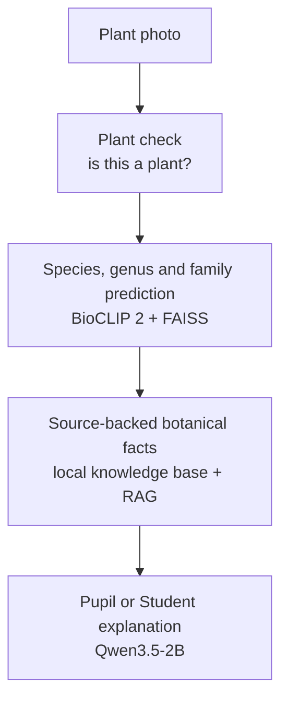

# 🌿 BotanicAI

### Visual plant identification and learning for botanical gardens.

Upload a plant photo. BotanicAI suggests its species, genus, and family,
shows confidence scores, and provides source-backed facts adapted for
two audiences: pupils and students.

[](https://www.python.org/)
[](LICENSE)
[](https://www.gradio.app/)
[](https://huggingface.co/imageomics/bioclip-2)


> Plant identification is probabilistic. Do not use the result to make
> decisions about edibility, toxicity, medical use, or conservation status.

---

## What it does

1. Checks whether the uploaded image appears to contain a plant.
2. Suggests a species or a short list of possible species.
3. Shows confidence at species, genus, and family levels.
4. Retrieves educational facts about the identified plant.
5. Adapts the explanation for pupils or students.
6. Links each fact to its source.

---

## Example

**Input:** Photograph of *Philodendron bipinnatifidum*

**Identification**

| Rank    | Prediction                   | Confidence |
| ------- | ---------------------------- | ---------- |
| Species | *Philodendron bipinnatifidum* | `__%`      |
| Genus   | *Philodendron*               | `__%`      |
| Family  | Araceae                      | `__%`      |

> Confidence values are produced by the app for each run. Replace `__%`
> with the real numbers (and a screenshot) from an actual identification —
> see [`docs/images/README.md`](docs/images/README.md). Numbers are never
> invented here.

**Pupil explanation**

> **It has its own "built-in heater."** This plant can actually warm itself
> up — it burns energy to raise its own temperature, which helps attract
> the insects that pollinate it.

**Student explanation**

> **Thermogenic metabolism.** *Philodendron bipinnatifidum* is thermogenic:
> its inflorescence oxidises lipids to generate heat, a rare trait among
> vascular plants that increases volatile emission and attracts pollinators.

In the app, every fact ships with a collapsible **View Source Quote**
panel and a link back to the source article, so each claim can be checked
against the text it came from.

---

## Pupil vs. Student modes

The same identification can be explained two ways. You choose the audience
with a tab; the underlying facts stay source-backed in both.

| Mode    | Intended audience | Style                                      |
| ------- | ----------------- | ------------------------------------------ |
| Pupil   | School visitors   | Short language and simple explanations     |
| Student | Older learners    | More detail and botanical terms            |

---

## How it works



1. **Plant check.** The image embedding is compared against a small set of
   reference phrases ("a photo of a plant", "a photo of a leaf", ...). If
   the closest match is not plant-like, the app warns that results may be
   unreliable.
2. **Identification.** [BioCLIP 2](https://huggingface.co/imageomics/bioclip-2)
   encodes the photo, and the embedding is searched (FAISS) against
   pre-computed species text embeddings to retrieve the top candidates.
3. **Confidence.** Scores are turned into calibrated species / genus /
   family confidence using empirical decile tables built from the margin
   between the top matches — not raw model logits. When the top-1 match is
   not reliable enough, the app shows a short *"one of"* candidate list
   instead of a single species.
4. **Facts (RAG).** The predicted name is looked up in a local knowledge
   base, falling back species → genus → family so there is always relevant
   context. [Qwen3.5-2B](https://huggingface.co/Qwen/Qwen3.5-2B) (run
   locally via [MLX](https://github.com/ml-explore/mlx)) is constrained to
   write a few short facts, each with a supporting quote drawn only from
   the retrieved text.
5. **Audience adaptation.** The same context is re-prompted for the Pupil
   or Student tab.

---

## Models, data, and source credits

| Component          | Source                                                                 | License          |
| ------------------ | ---------------------------------------------------------------------- | ---------------- |
| Image model        | [BioCLIP 2](https://huggingface.co/imageomics/bioclip-2)               | MIT              |
| Language model     | [Qwen3.5-2B](https://huggingface.co/Qwen/Qwen3.5-2B)                   | Apache 2.0       |
| Taxonomy           | [GBIF Backbone Taxonomy](https://www.gbif.org/dataset/d7dddbf4-2cf0-4f39-9b2a-bb099caae36c) | CC BY 4.0        |
| Reference images   | [Pl@ntNet-300K](https://zenodo.org/record/4726653)                     | per-image (varies) |
| Fact text          | [Wikipedia](https://www.wikipedia.org/)                                | CC BY-SA 4.0     |

Full details and attribution are in
[THIRD_PARTY_NOTICES.md](THIRD_PARTY_NOTICES.md). Model weights, datasets,
photographs, and generated indexes remain subject to their original terms
and are **not** covered by this project's license.

---

## Known limitations

- Similar species may be difficult to separate from one photograph.
- Image quality, lighting, and plant condition affect the result.
- Confidence is not the same as certainty.
- Educational facts depend on available sources; where a species is not
  covered, the app falls back to genus- or family-level information.
- The application is a prototype, not a scientific identification service.

---

## Setup

BotanicAI runs locally. Fact generation uses [MLX](https://github.com/ml-explore/mlx),
so the language model step is intended for **Apple Silicon** (M-series) Macs;
the BioCLIP identification step runs on CUDA, MPS, or CPU.

```bash
# 1. Clone and enter the project
git clone https://github.com/<your-username>/botanicai.git
cd botanicai

# 2. Install dependencies (a virtual environment is recommended)
pip install -r requirements.txt

# 3. Launch the app
python main.py
```

The app expects prepared data artifacts in `data/` (FAISS indexes, the
`taxa.parquet` lookup, the confidence decile tables, and the
`plants_knowledge.db` knowledge base). These are generated, not committed.
Build them with:

- `image_to_vector/prepare_text_embeddings.py` — species text embeddings → FAISS index
- `text/populate_database.py` — downloads reference text into the local knowledge base

Then open the local URL that Gradio prints (default `http://127.0.0.1:7860`).

---

## Project structure

```
botanicai/
├── main.py                        # Gradio UI + pipeline orchestration
├── image_to_vector/
│   ├── inference_bioclip.py       # BioCLIP 2 identification + confidence
│   ├── prepare_text_embeddings.py # Build the species FAISS index
│   ├── prepare_img_embeddings.py  # Build image embeddings (evaluation)
│   ├── evaluation_research.py     # Confidence calibration / evaluation
│   ├── evaluate_clip.ipynb        # Identification evaluation notebook
│   └── test_verification.ipynb    # Plant-check evaluation notebook
├── text/
│   ├── qwen.py                    # RAG retrieval + Qwen fact generation
│   └── populate_database.py       # Build the Wikipedia knowledge base
├── gbif_explore.ipynb             # GBIF taxonomy exploration
├── data/                          # Generated artifacts (gitignored)
├── docs/images/                   # Screenshots + demo GIF
├── requirements.txt
├── LICENSE                        # Apache License 2.0
└── THIRD_PARTY_NOTICES.md         # Model, dataset, and text attributions
```

---

## License

BotanicAI source code is licensed under the
[Apache License 2.0](LICENSE).

Third-party models and datasets remain subject to their original
licenses. See [THIRD_PARTY_NOTICES.md](THIRD_PARTY_NOTICES.md).
